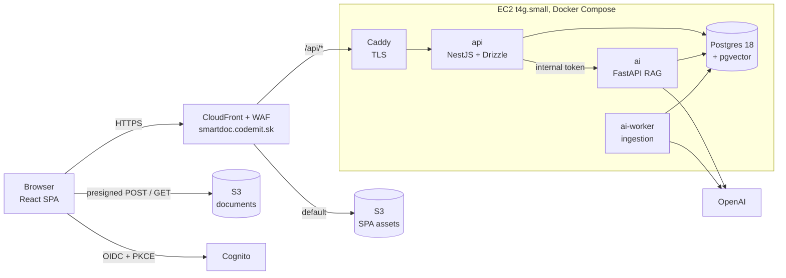

# SmartDoc AI

> Production-grade RAG with measured cost controls.

Invited users upload internal PDFs (manuals, policies) and chat with them. Answers stream in with page-level citations,
and every user sees only their own documents. Every LLM token is accounted for, and every cost or quality claim is backed
by a number the repo can reproduce.

**Status:** planning is complete; implementation has not started. Start with [docs/PLAN_SUMMARY.md](docs/PLAN_SUMMARY.md).
The planned demo URL is https://smartdoc.codemit.sk.

---

## Why this project

SmartDoc AI is a portfolio project. It is built to be defended in a technical interview, so its two headline claims are
**measured, not asserted**:

- **Cost.**
  - $/1k queries is measured on three replay arms: naive defaults, a sensible hand-tuned configuration, and fully optimized.
  - Savings are attributed to each mechanism.
  - Per-user daily budgets are enforced live.
- **Quality.**
  - The eval table below is generated from committed results JSON.
  - Retrieval metrics gate CI with zero API calls.
  - Generation and LLM-judge metrics run locally and are published with their caveats.

## Features (planned)

- Invite-only sign-in (Amazon Cognito managed login, OAuth code + PKCE).
- PDF upload straight to S3 via presigned POST (≤ 20 MB). Asynchronous ingestion: parse → chunk → embed.
- Hybrid retrieval: pgvector HNSW and Postgres full-text search, fused with Reciprocal Rank Fusion.
- Streaming answers (SSE) with numbered citations and "open PDF at page N".
- Abstains when retrieval is weak, without calling the LLM.
- Degraded mode: when OpenAI is unavailable, the app still returns the most relevant passages.
- A cost badge on every answer, and thumbs up/down feedback.
- An admin cost page: $/query, cache hit rates, spend by purpose, and a savings waterfall.

## Architecture



- **`api` (NestJS)**:
  - verifies Cognito access tokens and derives the tenant from `sub`;
  - owns the schema through Drizzle migrations;
  - presigns S3 uploads and downloads;
  - enforces budgets;
  - proxies the SSE stream and persists messages.

  It is the only container with AWS credentials.
- **`ai` (FastAPI)**:
  1. re-verifies the document scope;
  2. checks the exact-match cache;
  3. runs hybrid retrieval in a single SQL query;
  4. applies the relevance gate;
  5. builds a cache-aware prompt and streams the answer;
  6. writes one ledger row per billed API call.
- **`ai-worker`**:
  - claims ingestion jobs from a Postgres queue (`FOR UPDATE SKIP LOCKED` plus a lease);
  - parses PDFs in a resource-limited child process;
  - chunks, embeds and indexes.
- **Postgres + pgvector** holds relational data, vectors, full-text indexes, the job queue and the cost ledger.

Details: [docs/IMPLEMENTATION_PLAN.md](docs/IMPLEMENTATION_PLAN.md) §2 (request flows) and §4 (data model).

## Tech stack

| Layer | Choice |
|---|---|
| Frontend | React 19, Vite, TypeScript, TanStack Query, react-oidc-context, Recharts |
| API | NestJS, Drizzle ORM, aws-jwt-verify, pino |
| AI service | Python 3.13, FastAPI, official `openai` SDK, `langchain-text-splitters`, psycopg 3 + pgvector, pypdf |
| Data | PostgreSQL 18 + pgvector 0.8 (`halfvec(1536)`, HNSW) + full-text search |
| LLM | `gpt-6-luna` (Responses API, `effort: none`), `text-embedding-3-small` |
| Auth / storage | Amazon Cognito (invite-only), Amazon S3 |
| Infra | Docker Compose on EC2 (Graviton), CloudFront + WAF, Caddy, AWS CDK (TypeScript) |
| CI/CD | GitHub Actions: OIDC → ECR (arm64) → SSM deploy |
| Observability | Postgres ledger and quality tables (source of truth), Langfuse Cloud EU (traces) |
| Evaluation | In-process Python harness, RAGAS (judge metrics only) |

The RAG pipeline deliberately avoids framework chains and vector stores. Hybrid retrieval, caching and cost accounting are
written directly against the schema, so each can be inspected, measured and explained.
See [ADR-003 (planned)](docs/IMPLEMENTATION_PLAN.md#11-documentation-deliverables).

## Cost controls

| # | Mechanism | How it is measured |
|---|---|---|
| 1 | Reasoning and output controls (`effort: none`, low verbosity, output cap) | Reasoning/output token distributions; naive vs sensible replay delta |
| 2 | Relevance gate: skip the LLM when nothing relevant is retrieved | Refusal accuracy and false-refusal rate next to the estimated savings |
| 3 | Cache-aware prompt layout with one explicit breakpoint after a static prefix | Net savings from `cached_tokens` minus the cache-write premium |
| 4 | Context budget: top-5 chunks, ≤ 2,000 tokens | Recall@k and faithfulness for k = 3, 5 and 8 |
| 5 | History budget: last 3 turns, ≤ 800 tokens | Input tokens vs turn index |
| 6 | Exact response cache, tenant-scoped, invalidated when documents change | Hit rate; savings curve across repeat ratios |
| 7 | File-level dedup (SHA-256) | Embedding tokens saved |
| 8 | Budgets: per-user daily cap, global daily cap, OpenAI project hard limits | 429 count; overshoot bounded by one reservation |

Savings are always reported in **absolute dollars next to percentages**. The replay traffic is labeled as synthetic.

## Results

No results yet. The tables below are regenerated by `make eval-report` and are never edited by hand.

<!-- EVAL:START -->
_No eval results yet._
<!-- EVAL:END -->

| Cost replay (synthetic) | naive $/1k | sensible $/1k | optimized $/1k | Δ vs sensible | top levers |
|---|---|---|---|---|---|
| _not run yet_ | | | | | |

**Initial targets** (to be confirmed or refuted by the eval, and published either way):

| Metric | Target |
|---|---|
| Recall@5 | ≥ 0.85 |
| Refusal accuracy / false-refusal rate | ≥ 0.90 / ≤ 5% |
| Citation precision | ≥ 0.80 |
| Faithfulness (LLM judge, report-only) | ≥ 0.85 |
| Prompt-injection canaries that succeed | 0 / 12 |
| Cross-tenant retrievals in 100 probes | 0 |
| Uncached answered query cost | ≤ $0.0005 |
| p95 time to first token | ≤ 3 s |

## Security and privacy

- **Isolation:** every table is keyed by `tenant_id`, taken from the Cognito `sub`. Resources you do not own return 404. A generated IDOR test covers every `:id` route, and the AI service re-verifies document scope.
- **Uploads:** S3 keys are built by the server, the POST policy enforces size and type, magic bytes are checked, and object versions are pinned.
- **Prompt injection:** untrusted document text is escaped inside delimited tags, and the prompt includes an "untrusted data" rule. Output links are allowlisted and no remote images are rendered. Injection canaries are part of the eval.
- **Infrastructure:** no static AWS keys (OIDC, instance role, SSO), no SSH (SSM Session Manager), IMDSv2, and an origin reachable only through CloudFront. Logs are redacted.

Full threat table: [docs/IMPLEMENTATION_PLAN.md](docs/IMPLEMENTATION_PLAN.md) §9.

## Repository layout (planned)

```
apps/web            React SPA
apps/api            NestJS API, Drizzle schema and migrations
services/ai         FastAPI RAG service and ingestion worker
packages/contracts  Shared SSE event schemas and generated API types
eval/               Golden datasets, eval harness, committed results
infra/cdk           AWS CDK stacks (CI, storage, auth, compute, edge)
deploy/             Production compose file, Caddyfile, deploy scripts
docs/               Plan, PRD, architecture, ADRs, interview notes, build log
```

## Getting started (planned)

This section does not work yet. It describes how local development will work once Weekend 1 is done.

**Prerequisites:**
- Docker.
- Node 24+ with Yarn 4 (Corepack).
- uv.
- An AWS SSO profile with the dev stacks deployed.
- An OpenAI API key.

```bash
cp .env.example .env   # add your OpenAI key
make creds             # export short-lived credentials for the dev app role
make up                # start db, migrate, api, ai, ai-worker and web
make test              # unit and integration tests
make eval              # run the eval harness
```

Locally, Cognito and S3 are real dev resources. There is no emulator, because Cognito has no reliable one.

## Roadmap

- [ ] **Block 0.** Accounts, OpenAI API spike (streaming and prompt caching), toolchain.
- [ ] **Weekend 1: local MVP.**
  - compose stack and Drizzle schema;
  - Cognito auth;
  - presigned upload and the ingestion worker;
  - hybrid retrieval, streaming chat with citations, degraded mode;
  - chat UI.
- [ ] **Weekend 2: production.**
  - tenancy and IDOR tests;
  - AWS deployment through CDK, and CI/CD;
  - budgets, exact cache, dedup;
  - eval harness and sweeps;
  - cost replay and the Cost page;
  - docs and a restore drill.
- [ ] **Stretch.** Row-level security, semantic cache with a false-hit eval, reranking, promptfoo red-teaming, shared workspaces.

## Documentation

| Document | Contents |
|---|---|
| [docs/PLAN_SUMMARY.md](docs/PLAN_SUMMARY.md) | Condensed plan: decisions, architecture, schedule, verification |
| [docs/IMPLEMENTATION_PLAN.md](docs/IMPLEMENTATION_PLAN.md) | Full plan: SQL, SSE contract, flows, verification matrix, interview Q&A |
| [docs/planning/research/](docs/planning/research/) | Research reports with sources (LLM cost, Python stack, AWS, evaluation) |
| [docs/planning/reviews/](docs/planning/reviews/) | Adversarial reviews: interviewer, security/correctness, feasibility/cost |
| [docs/planning/draft-plan-v1.md](docs/planning/draft-plan-v1.md) | The draft plan as it stood before review |

Planned: `docs/PRD.md`, `docs/ARCHITECTURE.md`, `docs/adr/` (10 ADRs), `docs/INTERVIEW.md` and `docs/BUILD_LOG.md`.

## License

TBD.
