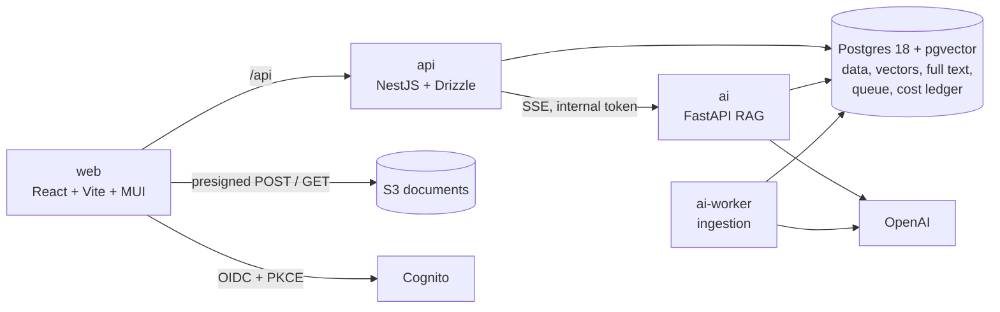

# SmartDoc AI

[](https://github.com/CodeMIT-s-r-o/SmartDoc-AI/actions/workflows/ci.yml)

> Production-grade RAG with measured cost controls.

Invited users upload internal PDFs (manuals, policies, laws) and chat with them. Answers stream in with page-level
citations, say "not in the documents" instead of guessing, and every user sees only their own documents. Every LLM token
is a priced ledger row, and every cost or quality claim is backed by a number the repo can reproduce.

**Status (2026-10-27):** feature-complete on the local stack (`make up`), which uses real dev AWS resources (Cognito, S3)
deployed with CDK. CI runs on every pull request.

What is left:
- the [golden-set review](docs/runbooks/golden-review.md) and the [calibration](docs/runbooks/calibration.md) that
  produce the official eval table;
- **deployment**, deliberately postponed: [deploy-prod.md](docs/runbooks/deploy-prod.md) is the step-by-step procedure
  for smartdoc.codemit.sk (≈ $10–14 a month), and its riskiest part, SSE through CloudFront and Lambda, is proven.

## Why this project

It is a portfolio project, built to be defended in a technical interview, so its two headline claims are **measured, not
asserted**:

- **Cost:**
  - $/1k queries measured on three replay arms (naive, sensible, optimized), with the savings attributed per mechanism;
  - per-user daily budgets that hold under concurrency.
- **Quality:**
  - retrieval metrics and 100 cross-tenant probes on every pull request, for $0, from a committed fixture;
  - a live tier with citations, refusals and injection canaries;
  - claims pre-registered before the first official run.

## Features

- **Upload:** invite-only sign-in (Cognito, OAuth code + PKCE). PDFs go straight to S3 by presigned POST (≤ 20 MB) with
  a checksum, are validated server-side and deduplicated by SHA-256.
- **Ingestion:** asynchronous, in a worker. A sandboxed parse, then chunk and embed, with retries and specific failure
  codes.
- **Retrieval:** hybrid, pgvector HNSW plus Postgres full text fused with Reciprocal Rank Fusion, in one SQL query.
- **Answers:**
  - streamed over SSE, with numbered citations, snippets and "open PDF at page N";
  - follow-up questions are rewritten into standalone ones;
  - a relevance gate refuses without an LLM call;
  - an exact answer cache serves repeats at $0;
  - a degraded mode (passages without generation) when OpenAI is down.
- **Cost:**
  - a cost badge on every answer;
  - per-user and global daily budgets with reservations, answering 429 + `Retry-After` when exhausted;
  - an admin Cost page: spend by purpose, cache hit rates, savings, the replay waterfall and the thumbs-down answers.
- **Feedback:** thumbs up or down with reasons, and conversation history.

## Architecture



- **`api`** owns identity, tenancy (`tenant_id` = the token's `sub`), the schema, presigned S3 access, budgets and the SSE
  pass-through. It is the only container with AWS credentials.
- **`ai`** runs the RAG pipeline:
  1. re-checks document scope;
  2. rewrites follow-ups;
  3. tries the exact cache;
  4. runs hybrid retrieval;
  5. applies the gate;
  6. streams a cache-friendly prompt;
  7. writes one ledger row per billed call.
- **`ai-worker`** claims ingestion jobs from a Postgres queue (`SKIP LOCKED` with leases), parses PDFs in a
  resource-limited child process, then chunks, embeds and indexes.

Diagrams of the flows, data ownership, capacity and failure modes: [docs/ARCHITECTURE.md](docs/ARCHITECTURE.md).

## Results

**Cost replay** (synthetic traffic, same questions through three configurations, costed from the ledger):

| Run | Naive $/1k | Sensible $/1k | Optimized $/1k | Δ vs sensible | Top levers |
|---|---|---|---|---|---|
| 2026-10-26, 238 queries per arm (48 exact repeats) | $0.46 | $0.36 | $0.20 | −43 % (−$0.15) | no reasoning −$0.11, prompt cache −$0.09, exact cache −$0.04 |

Results: [eval/results/replay-2026-10-26T213550-427784a.json](eval/results/replay-2026-10-26T213550-427784a.json).
Cheaper is not free: without reasoning the model declined more questions (24 → 50 of 238). Whether those refusals were
right is measured by the eval, not by the replay.

**Quality:** no official numbers yet. The golden set waits for its review, so the dry run (Hit@5 0.83, citation
precision 0.82, 0 of 12 injections) is not published as a result. The table below is filled by the calibration runbook
from committed results files only.

<!-- EVAL:START -->
_No eval results yet._
<!-- EVAL:END -->

**Targets**, to be confirmed or refuted, and published either way:

| Metric | Target |
|---|---|
| Recall@5 | ≥ 0.85 |
| Refusal accuracy / false refusals | ≥ 0.90 / ≤ 5 % |
| Citation precision | ≥ 0.80 |
| Injection canaries that succeed | 0 of 12 |
| Cross-tenant retrievals in 100 probes | 0 (met in every CI run) |
| Uncached answered query cost | ≤ $0.0005 (met: $0.00024 p50 in the replay) |
| p95 time to first token | ≤ 3 s |

**Single measurements** (dev stack, real OpenAI):

| Measurement | Value |
|---|---|
| Answer, prompt cache warm / cold | $0.000056 / $0.00038 |
| Question refused by the gate (no LLM call) | $0.00000016, 0.17 s |
| Repeat question, exact cache hit | $0, 11 ms |
| Ingesting a 102-page PDF (214 chunks) | $0.0015 |
| Retrieval over 1,002 chunks | p50 18.8 ms, p95 64 ms |
| Database restore, verified | RTO 8–11 s ([runbook](docs/runbooks/restore.md)) |

## Cost controls

| # | Mechanism | How it is measured |
|---|---|---|
| 1 | Reasoning and output controls (`effort: none`, low verbosity, output cap) | Naive vs sensible replay delta |
| 2 | Relevance gate: skip the LLM when nothing relevant is retrieved | Refusal accuracy and false refusals (calibration pending) |
| 3 | Cache-aware prompt layout with one explicit breakpoint after a static prefix | Net savings from cached tokens minus the write premium |
| 4 | Context budget: top-5 chunks, ≤ 2,000 tokens | Recall@k for k = 3, 5, 8 |
| 5 | History budget: last 3 turns, ≤ 800 tokens | Input tokens per turn |
| 6 | Exact answer cache, tenant-scoped, invalidated when documents change | Hit rate and booked savings |
| 7 | File-level dedup (SHA-256) | Embedding tokens saved |
| 8 | Budgets: per-user and global daily caps; OpenAI project hard limits | Overshoot bounded by one reservation |

## Security

- **Isolation:** every table carries `tenant_id`. Resources you do not own answer 404, an IDOR test generated from the
  mounted routes covers every `:id` route, and the AI service re-verifies document scope.
- **Uploads:** server-built S3 keys, a POST policy bounding size and type, a bound checksum, magic bytes checked on the
  pinned object version.
- **Prompt injection:** document text is delimited and escaped under an "untrusted data" rule. The markdown renderer
  allows no HTML, no images and no external links. 12 canaries run in the eval.
- **Secrets:** gitleaks runs in a pre-commit hook and in CI over the full history.

Details and residual risks: [docs/ARCHITECTURE.md](docs/ARCHITECTURE.md#security).

## Tech stack

| Layer | Choice |
|---|---|
| Frontend | React 19, Vite, TypeScript, MUI, TanStack Query, react-oidc-context, Recharts |
| API | NestJS 12, Drizzle ORM, aws-jwt-verify, pino, zod |
| AI service | Python 3.13, FastAPI, official `openai` SDK, `langchain-text-splitters`, psycopg 3 + pgvector, pypdf |
| Data | PostgreSQL 18 + pgvector 0.8 (`halfvec(1536)`, HNSW) + full-text search |
| LLM | `gpt-6-luna` (Responses API, `effort: none`), `text-embedding-3-small` |
| Auth / storage | Amazon Cognito (invite-only), Amazon S3 |
| Infra | AWS CDK (TypeScript). Production design: CloudFront, Lambda in a VPC with a NAT instance, Aurora Serverless v2 |
| CI | GitHub Actions: lint, types, tests, DB tests, offline eval, gitleaks |
| Evaluation | In-process Python harness; retrieval tier in CI from a fixture |

The RAG pipeline deliberately avoids framework chains and vector store libraries
([ADR-003](docs/adr/003-thin-ai-stack.md)), so every step can be inspected, measured and explained.

## Getting started

**Prerequisites:** Docker; Node 24+ and any global `yarn` (Yarn 4 is vendored); [uv](https://docs.astral.sh/uv/); an
OpenAI API key in `.env`; the one-time dev AWS setup and a daily `make creds`
([docs/runbooks/dev-aws.md](docs/runbooks/dev-aws.md)).

```bash
make install   # host dependencies for editors and tests (yarn + uv)
make up        # creates .env on first run, builds and starts the stack, waits until healthy
make check     # lint, type-check and test TypeScript and Python
make test-db   # database tests against smartdoc_test in the running stack
make help      # every target
```

| URL | Service |
|---|---|
| http://localhost:5173 | Web app: sign in with your invite (`/api` is proxied to the API) |
| http://localhost:3000/api/health | API health: database and AI service |

A realistic test document without licensed content: `cd services/ai && uv run python scripts/make_sample_pdf.py
handbook.pdf --pages 100`.

**Eval and cost:**

| Command | What it does | Cost |
|---|---|---|
| `make eval-ci` | Tier 1 as CI runs it: fresh database, committed fixture, no API calls | $0 |
| `make golden-review` | Review tool for the golden set ([runbook](docs/runbooks/golden-review.md)) | $0 |
| `make eval` | Tier 1 + tier 2 on reviewed items, writes `eval/results/` | ≈ $0.02 |
| `make replay` | Three-arm cost replay, writes `eval/results/replay-*.json` | ≈ $0.25 |
| `make restore-drill` | Back up, restore into a scratch Postgres, verify, print the RTO | $0 |

## Repository layout

```
apps/web            React SPA (Vite)
apps/api            NestJS API; Drizzle schema (src/db/schema.ts) and migrations (drizzle/)
services/ai         FastAPI RAG service, ingestion worker and eval harness (uv, Python 3.13)
packages/contracts  Shared SSE event schemas (zod)
deploy/db           Postgres role bootstrap
docs/               Architecture, PRD, interview notes, ADRs, runbooks, OpenAPI, build log
eval/               Corpus manifest, datasets, thresholds, claims, fixtures and committed results
infra/cdk           AWS CDK: dev storage and auth; the streaming spike (bin/spike.ts)
infra/spike         The streaming spike's two Lambda services and its check script
scripts/            Dev AWS config, invites, the CI eval and the restore drill
```

## Progress

| Stage | State |
|---|---|
| Local MVP: upload, ingestion, streaming chat with citations, UI | ✅ |
| Tenancy and IDOR tests, budgets, answer cache, follow-up rewrite, dedup | ✅ |
| Eval harness, datasets, offline CI tier | ✅ |
| Cost replay and the Cost page | ✅ (token reconciliation against the OpenAI usage export pending) |
| PRD, architecture, interview notes, 10 ADRs, restore drill, OpenAPI | ✅ |
| CI | ✅ |
| Golden-set review → calibration → official eval table | ⏳ [golden-review](docs/runbooks/golden-review.md), [calibration](docs/runbooks/calibration.md) |
| Deployment to smartdoc.codemit.sk | ⏸ postponed; [deploy-prod](docs/runbooks/deploy-prod.md) |
| Stretch: row-level security, semantic cache, reranking, red-teaming, shared workspaces | – |

Block-by-block history with planned against actual time: [docs/BUILD_LOG.md](docs/BUILD_LOG.md).

## Documentation

Start at [docs/README.md](docs/README.md): an index by purpose, the runbooks and the ADRs.

## License

TBD.
