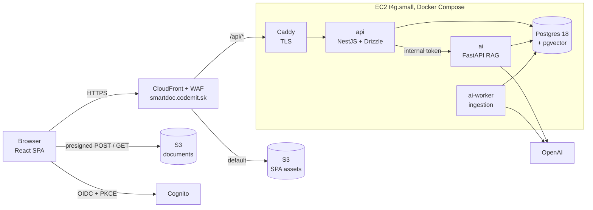

# SmartDoc AI

[](https://github.com/CodeMIT-s-r-o/SmartDoc-AI/actions/workflows/ci.yml)

> Production-grade RAG with measured cost controls.

Invited users upload internal PDFs (manuals, policies) and chat with them. Answers stream in with page-level citations,
and every user sees only their own documents. Every LLM token is accounted for, and every cost or quality claim is backed
by a number the repo can reproduce.

**Status:** the MVP works end to end on the local stack (`make up`) against real dev AWS resources (Cognito, S3)
deployed with CDK: upload, ingestion, streaming chat with page citations, cost per answer, feedback and per-user daily
budgets, an exact answer cache, standalone rewrite of follow-up questions and upload dedup. Next: the eval harness and
calibration; AWS deployment is postponed until after them. Not deployed yet, no other users. Progress and measurements:
[docs/BUILD_LOG.md](docs/BUILD_LOG.md); the plan: [docs/PLAN_SUMMARY.md](docs/PLAN_SUMMARY.md); deployment:
[docs/DEPLOY_PLAN.md](docs/DEPLOY_PLAN.md).
The planned demo URL is https://smartdoc.codemit.sk.

---

## Why this project

SmartDoc AI is a portfolio project. It is built to be defended in a technical interview, so its two headline claims are
**measured, not asserted**:

- **Cost.**
  - $/1k queries is measured on three replay arms: naive defaults, a sensible hand-tuned configuration, and fully optimized.
  - Savings are attributed to each mechanism.
  - Per-user daily budgets are enforced live.
- **Quality.**
  - The eval table below is generated from committed results JSON.
  - Retrieval metrics gate CI with zero API calls.
  - Generation and LLM-judge metrics run locally and are published with their caveats.

## Features

**Working now** (verified on the local stack, see the build log):

- Invite-only sign-in (Amazon Cognito managed login, OAuth code + PKCE).
- PDF upload straight to S3 via presigned POST (≤ 20 MB), validated server-side. Asynchronous ingestion in a worker:
  sandboxed parse → chunk → embed, with retries and specific failure codes (no text layer, encrypted, parse limits).
- Hybrid retrieval: pgvector HNSW and Postgres full-text search, fused with Reciprocal Rank Fusion.
- Streaming answers (SSE) with numbered citations, source snippets and "open PDF at page N".
- Abstains when retrieval is weak, without calling the LLM, and when the model finds no answer in the passages.
- Degraded mode: a circuit breaker returns the most relevant passages when OpenAI is unavailable.
- A cost badge on every answer (from the ledger), thumbs up/down with reasons, conversation history.
- Per-user and global daily budgets with reservations, 429 + `Retry-After` and a UI banner.
- Exact answer cache: the same question over the same documents is answered once, then served at $0.
- Follow-up questions ("and how many of them…") are rewritten into standalone questions for search.
- Upload dedup: the browser's SHA-256 finds an existing copy (409), and S3 rejects bytes that do not match it.
- Admin Cost page: ledger spend per day by purpose, cost per answer, cache hit rates, booked savings, the replay
  waterfall and the thumbs-down answers.

**Next:** the golden-set review and calibration, then AWS deployment ([plan](docs/DEPLOY_PLAN.md)).

## Architecture

The containers as they run today with Docker Compose, in the originally planned single-EC2 production layout.
[DEPLOY_PLAN.md](docs/DEPLOY_PLAN.md) replaces it with Lambda and Aurora Serverless v2 (the shape of the other CodeMIT
projects) once a streaming spike passes; the diagram changes with that decision.



- **`api` (NestJS)**:
  - verifies Cognito access tokens and derives the tenant from `sub`;
  - owns the schema through Drizzle migrations;
  - presigns S3 uploads and downloads;
  - enforces budgets;
  - proxies the SSE stream and persists messages.

  It is the only container with AWS credentials.
- **`ai` (FastAPI)**:
  1. re-verifies the document scope;
  2. checks the exact-match cache;
  3. runs hybrid retrieval in a single SQL query;
  4. applies the relevance gate;
  5. builds a cache-aware prompt and streams the answer;
  6. writes one ledger row per billed API call.
- **`ai-worker`**:
  - claims ingestion jobs from a Postgres queue (`FOR UPDATE SKIP LOCKED` plus a lease);
  - parses PDFs in a resource-limited child process;
  - chunks, embeds and indexes.
- **Postgres + pgvector** holds relational data, vectors, full-text indexes, the job queue and the cost ledger.

Details: [docs/IMPLEMENTATION_PLAN.md](docs/IMPLEMENTATION_PLAN.md) §2 (request flows) and §4 (data model).

## Tech stack

| Layer | Choice |
|---|---|
| Frontend | React 19, Vite, TypeScript, TanStack Query, react-oidc-context, Recharts |
| API | NestJS, Drizzle ORM, aws-jwt-verify, pino |
| AI service | Python 3.13, FastAPI, official `openai` SDK, `langchain-text-splitters`, psycopg 3 + pgvector, pypdf |
| Data | PostgreSQL 18 + pgvector 0.8 (`halfvec(1536)`, HNSW) + full-text search |
| LLM | `gpt-6-luna` (Responses API, `effort: none`), `text-embedding-3-small` |
| Auth / storage | Amazon Cognito (invite-only), Amazon S3 |
| Infra | AWS CDK (TypeScript). Planned: CloudFront, Lambda (container images), Aurora Serverless v2; EC2 as fallback |
| CI/CD | GitHub Actions: lint, types, tests, DB tests, offline eval, gitleaks. Planned deploy: OIDC → `cdk deploy` |
| Observability | Postgres ledger and quality tables (source of truth), Langfuse Cloud EU (traces) |
| Evaluation | In-process Python harness, RAGAS (judge metrics only) |

The RAG pipeline deliberately avoids framework chains and vector stores. Hybrid retrieval, caching and cost accounting are
written directly against the schema, so each can be inspected, measured and explained.
See [ADR-003](docs/adr/003-thin-ai-stack.md).

## Cost controls

| # | Mechanism | Status | How it is measured |
|---|---|---|---|
| 1 | Reasoning and output controls (`effort: none`, low verbosity, output cap) | done | Reasoning/output token distributions; naive vs sensible replay delta |
| 2 | Relevance gate: skip the LLM when nothing relevant is retrieved | done | Refusal accuracy and false-refusal rate next to the estimated savings |
| 3 | Cache-aware prompt layout with one explicit breakpoint after a static prefix | done | Net savings from `cached_tokens` minus the cache-write premium |
| 4 | Context budget: top-5 chunks, ≤ 2,000 tokens | done | Recall@k and faithfulness for k = 3, 5 and 8 |
| 5 | History budget: last 3 turns, ≤ 800 tokens | done | Input tokens vs turn index |
| 6 | Exact response cache, tenant-scoped, invalidated when documents change | done | Hit rate; savings curve across repeat ratios |
| 7 | File-level dedup (SHA-256) | done | Embedding tokens saved |
| 8 | Budgets: per-user daily cap, global daily cap, OpenAI project hard limits | caps done; OpenAI limits pending | 429 count; overshoot bounded by one reservation |

Savings are always reported in **absolute dollars next to percentages**. The replay traffic is labeled as synthetic.

## Results

**Measured so far** (single runs on the dev stack with real OpenAI, not eval results; details in the
[build log](docs/BUILD_LOG.md)):

| Measurement | Value |
|---|---|
| Answer with citations, prompt cache cold (prefix written) | $0.00038 |
| Same, prompt cache warm (1,264-token prefix read at 10%) | $0.000056 |
| Question refused by the relevance gate (no LLM call) | $0.00000016, 0.17 s |
| Same question again, exact cache hit (no embedding, no LLM) | $0, 11 ms (first answer $0.00032, 5.3 s) |
| Standalone rewrite of a follow-up question | $0.00003 |
| Degraded answer once the circuit breaker is open | $0, 0.26 s |
| Ingesting a 102-page PDF (214 chunks) | $0.0015 |
| NestJS proxy overhead on time to first token | ~60 ms |

No eval results yet. The tables below are regenerated by `make eval-report` and are never edited by hand.

<!-- EVAL:START -->
_No eval results yet._
<!-- EVAL:END -->

| Cost replay (synthetic) | naive $/1k | sensible $/1k | optimized $/1k | Δ vs sensible | top levers |
|---|---|---|---|---|---|
| 2026-10-26, 238 queries per arm (48 exact repeats) | $0.46 | $0.36 | $0.20 | −43 % (−$0.15) | no reasoning −$0.11, prompt cache −$0.09, exact cache −$0.04 |

Costs come from the ledger rows of each arm's requests ([results](eval/results/replay-2026-10-26T213550-427784a.json),
`make replay`). Cheaper is not free: without reasoning the model declined more questions (24 → 50 of 238), and that
quality cost is measured by the eval, not by the replay.

**Initial targets** (to be confirmed or refuted by the eval, and published either way):

| Metric | Target |
|---|---|
| Recall@5 | ≥ 0.85 |
| Refusal accuracy / false-refusal rate | ≥ 0.90 / ≤ 5% |
| Citation precision | ≥ 0.80 |
| Faithfulness (LLM judge, report-only) | ≥ 0.85 |
| Prompt-injection canaries that succeed | 0 / 12 |
| Cross-tenant retrievals in 100 probes | 0 |
| Uncached answered query cost | ≤ $0.0005 |
| p95 time to first token | ≤ 3 s |

## Security and privacy

- **Isolation:** every table is keyed by `tenant_id`, taken from the Cognito `sub`. Resources you do not own return 404. A generated IDOR test covers every `:id` route, and the AI service re-verifies document scope.
- **Uploads:** S3 keys are built by the server, the POST policy enforces size and type, magic bytes are checked, and object versions are pinned.
- **Prompt injection:** untrusted document text is escaped inside delimited tags, and the prompt includes an "untrusted data" rule. Output links are allowlisted and no remote images are rendered. Injection canaries are part of the eval.
- **Cost abuse:** per-user and global daily budgets with reservations, so parallel requests cannot overshoot by more than one reservation.
- **Infrastructure (production design, Weekend 2):** no static AWS keys (OIDC, instance role, SSO), no SSH (SSM Session Manager), IMDSv2, an origin reachable only through CloudFront, and redacted logs.

Full threat table: [docs/IMPLEMENTATION_PLAN.md](docs/IMPLEMENTATION_PLAN.md) §9.

## Repository layout

```
apps/web            React SPA (Vite)
apps/api            NestJS API; Drizzle schema (src/db/schema.ts) and migrations (drizzle/)
services/ai         FastAPI RAG service and ingestion worker (uv, Python 3.13)
packages/contracts  Shared SSE event schemas (zod)
deploy/             Postgres role bootstrap; production compose, Caddyfile and deploy scripts later
docs/               Plan, ADRs, build log; PRD, architecture and interview notes later
eval/               (Weekend 2) golden datasets, eval harness, committed results
infra/cdk           AWS CDK stacks: storage and auth now; CI, compute and edge in Weekend 2
```

## Getting started

**Prerequisites:**
- Docker.
- Node 24+ and any global `yarn`. The repo vendors Yarn 4 in `.yarn/releases`, so Corepack is not needed.
- [uv](https://docs.astral.sh/uv/). It installs Python 3.13 by itself.
- An OpenAI API key in `.env`: the ingestion worker needs it (embeddings), and so does `make spike`.

```bash
make install   # host dependencies for editors and tests (yarn + uv)
make up        # creates .env on first run, builds and starts the stack, waits until healthy
make check     # lint, type-check and test TypeScript and Python
make test-db   # database tests against smartdoc_test in the running stack (needs make up)
make spike     # OpenAI API spike (needs OPENAI_API_KEY in .env, costs < $0.01)
```

A realistic test document, without any licensed content:

```bash
cd services/ai && uv run python scripts/make_sample_pdf.py handbook.pdf --pages 100
```

| URL | Service |
|---|---|
| http://localhost:5173 | Web app: sign in with your invite (proxies `/api` to the API) |
| http://localhost:3000/api/health | API health: database and AI service status |
| http://localhost:8000/internal/health | AI service health (internal network only in production) |

Source folders are bind-mounted, so the API, the AI service and the web app reload on save.
Cognito and S3 are real dev resources; there is no emulator, because Cognito has no reliable one.
One-time AWS setup and daily `make creds`: [docs/runbooks/dev-aws.md](docs/runbooks/dev-aws.md).
`make help` lists all targets.

## Roadmap

- [ ] **Block 0.** Accounts, OpenAI API spike (streaming and prompt caching), toolchain.
  - [x] toolchain and monorepo scaffold (NestJS 12, Vite, FastAPI, Postgres + pgvector), `make up` healthy;
  - [x] OpenAI spike (`make spike`);
  - [ ] accounts: OpenAI projects and limits, AWS eligibility check, corpus PDFs.
- [x] **Weekend 1: local MVP.**
  - compose stack and Drizzle schema;
  - Cognito auth;
  - presigned upload and the ingestion worker;
  - hybrid retrieval, streaming chat with citations, degraded mode;
  - chat UI.
- [ ] **Weekend 2: production** (in progress).
  - [x] tenancy and IDOR tests;
  - [ ] AWS deployment through CDK, and CI/CD;
  - [x] budgets;
  - [x] exact cache, follow-up rewrite, dedup;
  - [ ] eval harness and sweeps;
  - [x] cost replay and the Cost page (token reconciliation against the OpenAI usage export pending);
  - [ ] docs and a restore drill.
- [ ] **Stretch.** Row-level security, semantic cache with a false-hit eval, reranking, promptfoo red-teaming, shared workspaces.

## Documentation

| Document | Contents |
|---|---|
| [docs/PLAN_SUMMARY.md](docs/PLAN_SUMMARY.md) | Condensed plan: decisions, architecture, schedule, verification |
| [docs/IMPLEMENTATION_PLAN.md](docs/IMPLEMENTATION_PLAN.md) | Full plan: SQL, SSE contract, flows, verification matrix, interview Q&A |
| [docs/planning/research/](docs/planning/research/) | Research reports with sources (LLM cost, Python stack, AWS, evaluation) |
| [docs/planning/reviews/](docs/planning/reviews/) | Adversarial reviews: interviewer, security/correctness, feasibility/cost |
| [docs/planning/draft-plan-v1.md](docs/planning/draft-plan-v1.md) | The draft plan as it stood before review |
| [docs/BUILD_LOG.md](docs/BUILD_LOG.md) | Planned vs actual time per block, surprises, measurements |
| [docs/adr/](docs/adr/) | Architecture decision records (6 of 10 so far) |

Planned: `docs/PRD.md`, `docs/ARCHITECTURE.md`, the remaining ADRs and `docs/INTERVIEW.md`.

## License

TBD.
