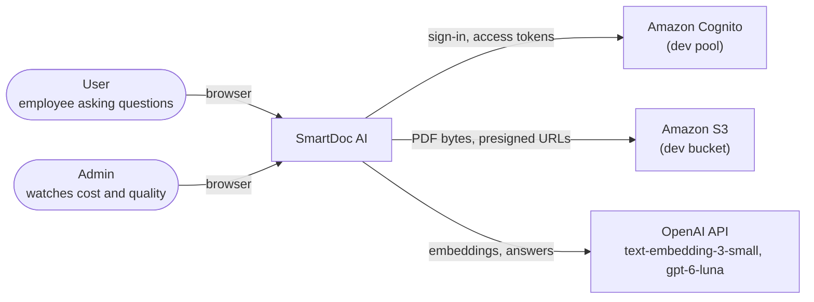
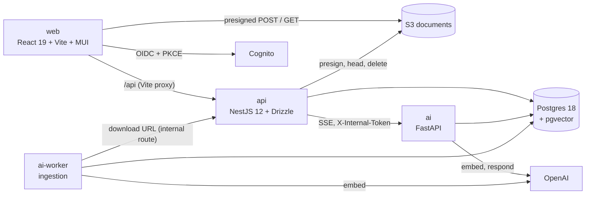
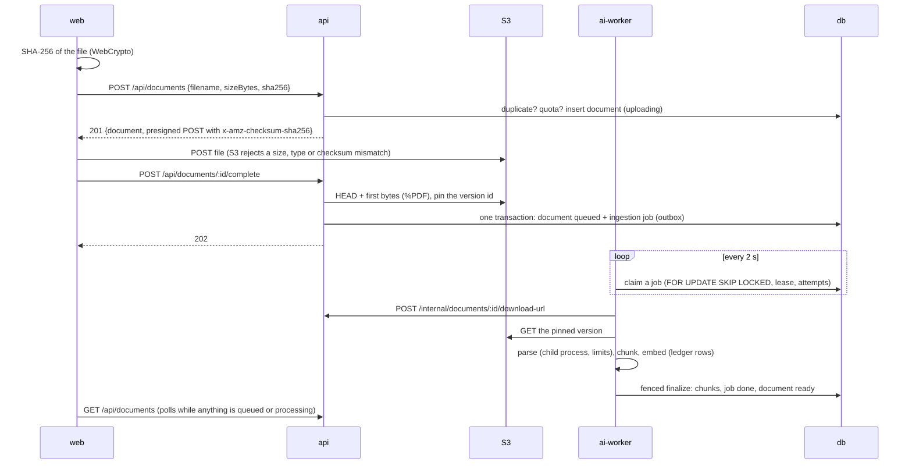
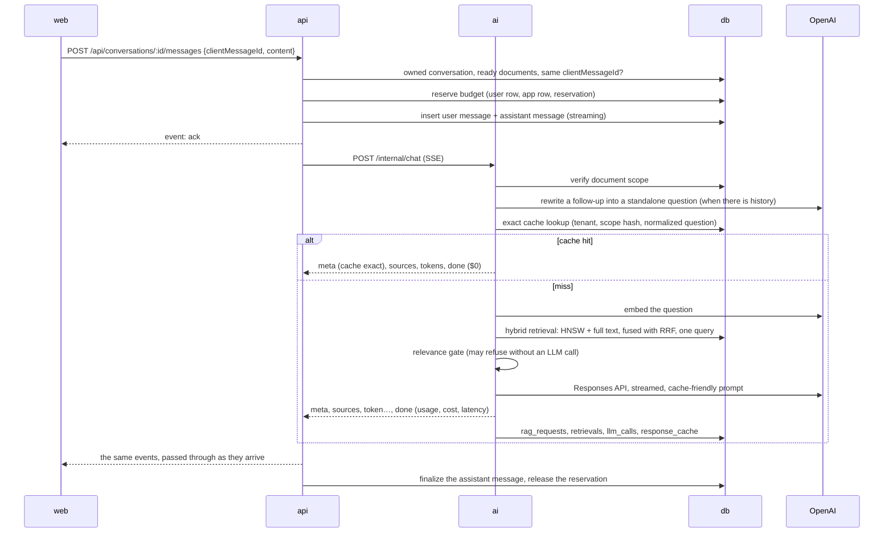

# SmartDoc AI: architecture

How SmartDoc is built today (the local stack, `make up`), why, and where it would go next. Decisions
with their own records are in [adr/](adr/); the production design is in
[DEPLOY_PLAN.md](DEPLOY_PLAN.md); the REST contract is [openapi.yaml](openapi.yaml).

## Context

Cognito and S3 are real AWS resources even on localhost ([ADR-009](adr/009-compute-and-edge.md)):
there is no reliable Cognito emulator, and S3 behaviour (POST policies, checksums, versions) is part
of what is tested.

## Containers

| Container | Responsibility | Holds |
|---|---|---|
| `web` | Sign-in, documents, chat with citation chips, Cost page for admins | no secrets |
| `api` | Tokens and tenant, documents and conversations, presigned S3, budgets, the SSE pass-through and message persistence, admin aggregates | the only AWS credentials (`SmartDocDevApp` role) |
| `ai` | Scope check, follow-up rewrite, exact cache, hybrid retrieval, relevance gate, prompt, streamed answer, ledger rows | the OpenAI key |
| `ai-worker` | Claims ingestion jobs; parses PDFs in a resource-limited child process; chunks, embeds, indexes | the OpenAI key |
| `db` | All data: relational, vectors, full text, the queue, the ledger ([ADR-002](adr/002-pgvector-single-store.md)) | two roles: owner (DDL) and app (DML) |

Why two services ([ADR-001](adr/001-service-split.md)): the RAG pipeline and its eval harness share
Python code, and the API owns identity, tenancy and money.

## Flows

### Upload and ingestion

### Asking a question

A repeated `clientMessageId` returns the stored turn as JSON instead of a second LLM call. The event
contract is the zod schema in `packages/contracts`.

### Deleting a document

1. `status = 'deleting'`: the document leaves chat scope at once.
2. One transaction:
   - strip its snippets from past answers' citations;
   - delete the document row (chunks and jobs cascade);
   - empty the tenant's answer cache.
3. Delete every S3 version under its prefix. A failure here leaves orphans under a known prefix,
   logged for a reconciler; the document is already gone everywhere it could be read from.

## Data

| Table | Written by | What it holds |
|---|---|---|
| `users` | api | Cognito `sub`, email, daily limit, last seen |
| `documents`, `ingestion_jobs` | api (create, complete, delete), worker (progress, finalize) | upload state machine; the queue with leases |
| `chunks` | worker | text, `halfvec(1536)`, generated `tsvector`, pages, section path |
| `conversations`, `messages`, `feedback` | api | turns with status, citations and idempotency keys; thumbs with reasons |
| `rag_requests`, `retrievals` | ai | one row per question: status, cache type, cost, latencies; the ranked candidates |
| `llm_calls` | ai, worker (ledger) | one row per billed API call; a trigger prices it from `model_prices` |
| `user_daily_usage`, `app_daily_usage` | ledger trigger (spend), api (reservations) | per-day spend and reserved amounts, Europe/Bratislava days |
| `budget_reservations` | api | one reservation per request, released at the end or by the sweeper |
| `response_cache`, `cost_savings` | ai (api empties the cache on delete) | exact answers; booked savings by mechanism |
| `model_prices` | migrations | versioned prices, no overlaps (EXCLUDE constraint) |

Every tenant-owned table carries `tenant_id`. Ledger rows are written in their own transaction, so a
failed request is still billed ([ADR-008](adr/008-cost-ledger.md)).

## Capacity

Measured on the eval corpus (1,002 chunks, [ADR-002](adr/002-pgvector-single-store.md)).

- **Storage:** 11.9 KB per chunk in total; the HNSW index is 4.1 KB per vector.
- **Retrieval latency:** p50 18.8 ms, p95 64.1 ms.

| Chunks | Size | Where it fits |
|---|---|---|
| 1k | 12 MB | anything |
| 50k | ≈ 0.6 GB | a small instance |
| 600k | ≈ 7 GB | a dedicated 16 GB host |

**Switch** to partitioning or a dedicated vector engine above ≈ 10M vectors, or when retrieval p95
passes 100 ms.

## Failure modes

| Failure | Detection | Behaviour |
|---|---|---|
| OpenAI slow or down | timeouts: embed 5 s, rewrite 5 s, first token 20 s, answer 60 s; breaker opens after 5 failures in 60 s, for 30 s | **degraded answer:** the most relevant passages without generation; keyword-only retrieval if embedding fails |
| AI service hangs | api stream limit 120 s | `error` event `UPSTREAM_TIMEOUT`; the message is finalized as an error |
| Client disconnects mid-answer | `close` on the response | the upstream request is aborted, and the message is finalized as `aborted` |
| api restarts mid-answer | housekeeping every 60 s | `streaming` messages older than 2 min are closed |
| Request dies holding a reservation | reservation TTL 5 min | the sweeper releases it; the budget never stays blocked until midnight |
| Worker crash or OOM | job lease 15 min, attempts counted at claim | reclaimed; a poison PDF runs out of attempts |
| Bad PDF | parser in a child process with limits | permanent codes (`NO_TEXT_LAYER`, `ENCRYPTED`, …) fail at once |
| Database lost | restore drill | RTO 8–11 s locally, all tables verified ([runbooks/restore.md](runbooks/restore.md)) |
| Cost spike | reservations against per-user and app daily limits | 429 `BUDGET_EXCEEDED` with `Retry-After`; overshoot is bounded by one reservation |

## Security

- **Controls:**
  - **Tenancy:** the tenant comes from the token's `sub`. Every query is scoped by it. Foreign ids
    answer 404, and a generated IDOR test covers every `:id` route.
  - **Scope re-check:** the AI service re-verifies document scope.
  - **Uploads:** the server builds the S3 keys; the POST policy limits size and type; the
    checksum is bound; the magic bytes are checked; versions are pinned.
  - **Prompt injection:** document text is delimited and escaped, with an "untrusted data" rule.
    12 canaries in the eval: 0 succeeded in the dry run.
  - **Output:** the markdown renderer allows no raw HTML and no images, and links point only to the
    app's own origin.
  - **Secrets:** gitleaks runs in a pre-commit hook and in CI over the full history; only `api`
    holds AWS credentials.
- **Residual risks:**
  - injection success is bounded only statistically (0 of 12 still allows up to 24 %);
  - no row-level security: isolation relies on the query layer and its tests;
  - S3 orphans after a failed delete wait for a reconciler that does not exist yet;
  - the dev stack's credentials last 12 hours and live in a local file.

## Scaling path

1. **Production as designed** ([DEPLOY_PLAN.md](DEPLOY_PLAN.md)): Lambda functions scale per
   request, and Aurora Serverless v2 scales in ACUs.
2. **Ingestion:** SQS instead of polling; more workers.
3. **Retrieval:**
   - measure EXPLAIN at 50k chunks;
   - partition `chunks` by tenant when single-tenant scans dominate;
   - a dedicated vector store only past the switch points above.
4. **Cost:** a semantic cache tier, after an eval of its false hits
   ([ADR-005](adr/005-gate-and-answer-cache.md)).

## Decisions without an ADR

- **Contracts:** Drizzle owns the schema and migrations. Hand-written SQL covers what drizzle-kit
  cannot express (HNSW, EXCLUDE, triggers).
- **API errors and contract:** RFC 9457 problem details with a machine `code`. The REST contract is
  [openapi.yaml](openapi.yaml), written by hand and tested against the mounted routes, instead of
  `@nestjs/swagger` decorators.
- **SSE contract:** zod schemas shared by the api and the web app, plus a JSON Schema for Python.
- **Tooling:** a monorepo with Yarn 4 workspaces and uv; one `make` vocabulary for laptops and CI.
- **Web:** react-markdown with an allowlist instead of a sanitizer; citations as `#cite-N` links
  rendered as chips.
